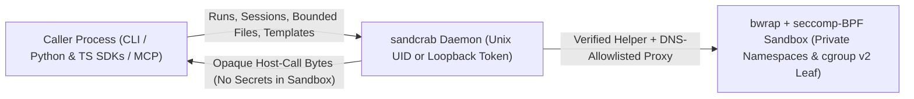

# Sandcrab

Sandcrab runs commands from AI agents, build and test steps and other
semi-trusted programs in isolated sandboxes on the same Linux host as your
application.

Your application talks to a local service over a Unix socket or a loopback port.
It can run a single command, or open a persistent bash session with bounded file
operations, durable volumes and reusable templates. The host needs Linux 5.11+,
delegated cgroup v2 and unprivileged user namespaces. Neither KVM nor a container
daemon is required. Releases ship static `x86_64` and `aarch64` binaries alongside
a checksum-verified `bubblewrap` helper and compiled seccomp-BPF filters.



## When Sandcrab fits

Sandcrab fits when one Linux server must run code that an application or agent
chose, with bounded files, processes, network destinations and resources, and
without KVM, Kubernetes or a container runtime.

It does not fit when:

- workloads come from mutually hostile tenants or must be protected from kernel
  vulnerabilities, because sandboxes share the host kernel
  ([threat model](THREAT-MODEL.md));
- execution must spread across a cluster, because Sandcrab manages one host;
- the service must run natively on macOS or Windows; see
  [developer hosts](crates/sandcrab/docs/developer-hosts.md) for development
  setups on those systems.

The table compares designs; it does not report measurements.

| Capability | Raw `bwrap` / subprocess | Docker Engine | MicroVM (Firecracker / Kata) | Sandcrab |
|---|---|---|---|---|
| Host prerequisite | Linux user namespaces | Root container daemon | `/dev/kvm` or nested virt | Linux 5.11+, cgroup v2, userns (no KVM) |
| Kernel boundary | Shared host kernel | Shared host kernel | Guest kernel | Shared host kernel ([threat model](THREAT-MODEL.md)) |
| Persistent shell + bounded file API | Manual scripting | Exec + full archive copy | Custom guest agent | Native sessions, byte/line reads, `mkdir`/`ls`/`search` |
| Fast environment resets | Full directory copy | Image pull / container recreate | Snapshot + VM boot | Content-addressed overlay templates & layer recipes |
| Egress & secret isolation | Host network or full netns | Bridge / iptables rules | Virtual NIC + tap | Exact-domain CONNECT/SOCKS5 allowlist + caller-owned [host calls](crates/sandcrab/host-calls.md) |

See the [provider decision](notes/implemented/2026-11-02-sandcrab-lightweight-service.md)
for runtime and measurement trade-offs.

## Quickstart

On Ubuntu 22.04, Ubuntu 24.04 or Debian 12, run these three commands from a root
shell on the systemd host. They download [v0.3.0](https://github.com/core607/sandcrab/releases/tag/v0.3.0),
install the service and execute Python. A private mirror can supply an authorized
asset URL through `SANDCRAB_BUNDLE_URL`.

<!-- sandcrab-quickstart -->
```sh
curl --fail --silent --show-error --location --output sandcrab-linux-x86_64.zip "${SANDCRAB_BUNDLE_URL:-https://github.com/core607/sandcrab/releases/download/v0.3.0/sandcrab-linux-x86_64.zip}"
python3 -I sandcrab-linux-x86_64.zip
/var/lib/sandcrab-release/sandcrab run --socket /var/lib/sandcrab/runtime/control.sock --profile default -- python3 -c 'print(6 * 7)'
```

The last command returns a JSON record with `state` equal to `succeeded` and
`42` in `result.stdout`. On `aarch64` hosts, substitute `sandcrab-linux-aarch64.zip`
in the download and `python3 -I` commands. The installer creates the execution account,
local service, `/usr/local/bin/sandcrab` symlink (when `/usr/local/bin` is protected)
and private token. The [installation guide](crates/sandcrab/install/README.md) covers
`doctor`, `upgrade`, `uninstall` and the [container quickstart](crates/sandcrab/install/README.md#standalone-container).

<a id="cookbook"></a>

## Connect an application

As an administrator, provision a private `0600` token for the application account.
Replace `app` with the existing Linux account that will run the SDK.

```sh
sudo install -d -o root -g root -m 0711 /etc/sandcrab-client
sudo sandcrab client-token --user app --output /etc/sandcrab-client/token
```

In the application's shell, set the connection defaults and run a command.

```sh
export SANDCRAB_ENDPOINT=http://127.0.0.1:9011
export SANDCRAB_TOKEN_FILE=/etc/sandcrab-client/token
export SANDCRAB_PROFILE=default

sandcrab run --timeout 30s --memory 64Mi -- python3 -c 'print("hello")'
```

From an empty project on the service host, follow the
[Python quickstart](sdk/python/README.md#run-your-first-session) or
[TypeScript quickstart](sdk/typescript/README.md#run-your-first-session).
Both examples install the SDK, execute a Python file in a session, print `42`
and clean up. The service also supports published Python and Kotlin
[OpenSandbox clients](crates/sandcrab/opensandbox.md) ([Python](examples/sandcrab-sdk.py),
[Kotlin](examples/sandcrab-sdk.main.kts)).

## Give an agent a sandbox

To expose bounded sandbox execution and workspace file tools to an MCP host over
stdio (`sandcrab-mcp` from the Python SDK, or
[examples/sandcrab-mcp.py](examples/sandcrab-mcp.py)):

```sh
sandcrab-mcp --endpoint http://127.0.0.1:9011 --token-file /etc/sandcrab-client/token --profile default
```

An application that already gives its model shell and file tools must move all of
them into Sandcrab. A file tool that keeps reading or writing host paths bypasses
the sandbox even when its shell tool runs inside one.

## Templates

Import a small workspace with the default profile. The CLI streams plain tar or
decompresses `.tar.gz` and `.tgz` before sending the archive.

<!-- sandcrab-template-example -->
```sh
printf 'print(6 * 7)\n' > app.py
tar -czf workspace.tar.gz app.py
sandcrab template import --profile default ./workspace.tar.gz
```

Pass the returned 64-hex `id` to `session open --template ID`. To use a container
filesystem, import its exported tar under a profile whose `transfer_bytes` covers
the unpacked archive, then open the template with `--rootfs`. The
[rootfs requirements](crates/sandcrab/docs/templates.md) describe its shell and mount layout.
The [Python template extension](sdk/python/README.md)
also captures validated sessions into reusable checkpoints and composes multi-layer
recipes.

## Network and secrets

Permit exact DNS destinations in `/etc/sandcrab/config.toml` while keeping signing
keys and API credentials in the caller process via [host calls](crates/sandcrab/host-calls.md):

```toml
[profiles.build]
exec_user = "sandcrab-exec"
tools = "/var/lib/sandcrab/tools"
read_only = ["/usr", "/bin", "/lib", "/lib64", "/etc/ld.so.cache"]
memory_bytes = 268435456
temporary_bytes = 33554432
temporary_inodes = 4096
tasks_max = 64
cpu_quota_percent = 100
timeout_millis = 60000
session_ttl_millis = 300000
output_limit_bytes = 262144
network = { allow = ["pypi.org", "files.pythonhosted.org"] }
host_calls = true
```

Inside the sandbox, `sandcrab call -` sends opaque request bytes to your caller's
`HostCallDispatcher` (see [examples/sandcrab-host-calls.py](examples/sandcrab-host-calls.py)),
so private keys never enter read mounts, environment variables or checkpoints.
The [build-test](examples/sandcrab-build-test.sh) and [batch](examples/sandcrab-batch.py)
examples drive the CLI:

```sh
curl --fail --unix-socket /var/lib/sandcrab/runtime/control.sock http://localhost/v1/info
bash examples/sandcrab-build-test.sh
python3 examples/sandcrab-batch.py first.py second.py
```

## Reference

| Topic | Page |
|---|---|
| Native API, CLI and configuration | [Native service reference](crates/sandcrab/README.md) and its topic pages |
| HTTP contract | [OpenAPI](crates/sandcrab/openapi.json) |
| Installation, upgrades and containers | [Installation guide](crates/sandcrab/install/README.md) |
| Development on macOS or Windows | [Developer hosts](crates/sandcrab/docs/developer-hosts.md) |
| SDKs | [Python](sdk/python/README.md), [TypeScript](sdk/typescript/README.md) |
| OpenSandbox clients | [OpenSandbox adapter](crates/sandcrab/opensandbox.md) and [same-host Docker comparison](benchmarks/density/opensandbox/README.md#l9-measurement) |
| Trust and isolation boundaries | [Threat model](THREAT-MODEL.md) |

## Build and test

From the repository root, use the pinned Linux build environment (`--platform linux/arm64`
builds the `aarch64` release bundle).

```sh
docker build --target release --output type=local,dest=build/bin .
docker build --target check .
python3 crates/sandcrab/conformance.py --list
```

The release contains the executables, installer ZIP (`sandcrab-linux-x86_64.zip` or
`sandcrab-linux-aarch64.zip`), SHA-256 manifest, project license, threat model and the
helper's notices and source. The [conformance runner](crates/sandcrab/docs/verification.md)
exercises real Linux sandboxes. [Inspect evals](evals/README.md) test agent use of the API.
The [density benchmark](benchmarks/density/README.md) measures a reproducible workload.

For a stable release above 0.3.1, set the service and both SDKs to the same
version before tagging the commit. The [release workflow](.github/workflows/publish-sdks.yml)
tests both packaged README examples against that commit's service archive. It
publishes the service, then PyPI and npm, verifying the uploaded bytes at each
destination. Rerun failed jobs to finish a partial release. A manual run with
`candidate_tag` checks the proposed version and runs acceptance without publishing.

Maintainers can test a released ZIP against a reviewed commit on a public consumer's own
branch. Add the repository to the JSON array in the `SANDCRAB_DOWNSTREAM_REPOSITORIES`
Actions variable. The consumer provides `.github/ci/sandcrab-release-check.sh`, receives
the ZIP in `SANDCRAB_BUNDLE`, and writes test output under `SANDCRAB_EVIDENCE`. The receipt
records the tested commit, archive digest and result. [Downstream release check](.github/workflows/downstream-release.yml)
also accepts a bounded `check` name to select `.github/ci/sandcrab-NAME-check.sh`.
Additional checks receive Node.js 24.19.0 and Python 3.12.14; their receipt names the
check so a different acceptance cannot satisfy it. The default `release` entry
and receipt remain the standard release check.

Sandcrab is licensed under [Apache 2.0](LICENSE). The separate bundled helper and
its dependencies retain their [upstream licenses and corresponding source](crates/sandcrab-launch/bwrap/README.md).
Releases also carry the locked Cargo dependencies' original license and notice
texts and the pinned Rust standard library's copyright report, available offline
in the ZIP, installation directory and container image.
