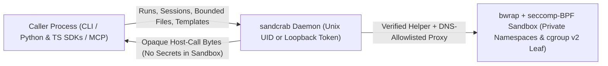

# Sandcrab

Sandcrab is a same-host Linux sandbox service for AI agents, untrusted build/test
steps and interactive tool sessions. Submit a finite command, or open a persistent
bash session backed by bounded workspace file operations, volumes and immutable
overlay templates. Releases ship static `x86_64` and `aarch64` binaries alongside a
checksum-verified `bubblewrap` helper and compiled seccomp-BPF filters; the host
needs Linux 5.11+, delegated cgroup v2 and unprivileged user namespaces, with no KVM
or container daemon required.



## When to choose Sandcrab

| Capability | Raw `bwrap` / subprocess | Docker Engine | MicroVM (Firecracker / Kata) | Sandcrab |
|---|---|---|---|---|
| Host prerequisite | Linux user namespaces | Root container daemon | `/dev/kvm` or nested virt | Linux 5.11+, cgroup v2, userns (no KVM) |
| Kernel boundary | Shared host kernel | Shared host kernel | Guest kernel | Shared host kernel ([threat model](THREAT-MODEL.md)) |
| Persistent shell + bounded file API | Manual scripting | Exec + full archive copy | Custom guest agent | Native sessions, byte/line reads, `mkdir`/`ls`/`search` |
| Fast environment resets | Full directory copy | Image pull / container recreate | Snapshot + VM boot | Content-addressed overlay templates & layer recipes |
| Egress & secret isolation | Host network or full netns | Bridge / iptables rules | Virtual NIC + tap | Exact-domain CONNECT/SOCKS5 allowlist + caller-owned [host calls](crates/sandcrab/host-calls.md) |

See the [provider decision](notes/implemented/2026-11-02-sandcrab-lightweight-service.md)
for runtime and measurement trade-offs, and the [threat model](THREAT-MODEL.md) for
shared-kernel trust boundaries.

## Quickstart

On Ubuntu 22.04, Ubuntu 24.04 or Debian 12, run these three commands from a root
shell on the systemd host. They download [v0.2.0](https://github.com/core607/sandcrab/releases/tag/v0.2.0),
install the service and execute Python. A private mirror can supply an authorized
asset URL through `SANDCRAB_BUNDLE_URL`.

<!-- sandcrab-quickstart -->
```sh
curl --fail --silent --show-error --location --output sandcrab-linux-x86_64.zip "${SANDCRAB_BUNDLE_URL:-https://github.com/core607/sandcrab/releases/download/v0.2.0/sandcrab-linux-x86_64.zip}"
python3 -I sandcrab-linux-x86_64.zip
/var/lib/sandcrab-release/sandcrab run --socket /var/lib/sandcrab/runtime/control.sock --profile default -- python3 -c 'print(6 * 7)'
```

The last command returns a JSON record with `state` equal to `succeeded` and
`42` in `result.stdout`. On `aarch64` hosts, substitute `sandcrab-linux-aarch64.zip`
in the download and `python3 -I` commands. The installer creates the execution account,
local service, `/usr/local/bin/sandcrab` symlink (when `/usr/local/bin` is protected)
and private token. The [installation guide](crates/sandcrab/install/README.md) covers
`doctor`, `upgrade`, `uninstall` and the [container quickstart](crates/sandcrab/install/README.md#standalone-container).

## Cookbook

### 1. Grant a non-root service account client access

Provision a private `0400` token copy owned by your application user without sharing
root access to `/etc/sandcrab/token`, then set connection defaults via environment
variables:

```sh
sudo sandcrab client-token --user app --output /etc/app/sandcrab.token
export SANDCRAB_ENDPOINT=http://127.0.0.1:9011
export SANDCRAB_TOKEN_FILE=/etc/app/sandcrab.token
export SANDCRAB_PROFILE=default

sandcrab run --timeout 30s --memory 64Mi -- python3 -c 'print("hello")'
```

### 2. Drive sessions from Python, TypeScript or an MCP agent

The native [Python SDK](sdk/python/README.md) and zero-dependency
[TypeScript SDK](sdk/typescript/README.md) close and forget sessions automatically
when leaving scope; the installed service also supports published Python and Kotlin
[OpenSandbox clients](crates/sandcrab/opensandbox.md) ([Python](examples/sandcrab-sdk.py),
[Kotlin](examples/sandcrab-sdk.main.kts)).

```python
from sandcrab import SandcrabClient

with SandcrabClient() as client:  # reads SANDCRAB_ENDPOINT / SANDCRAB_TOKEN_FILE / SANDCRAB_PROFILE
    with client.open_session() as session:
        session.write_file("src/app.py", "print(6 * 7)\n", parents=True)
        result = session.exec("python3 src/app.py", check=True)
```

```ts
import { SandcrabClient } from "sandcrab";

const client = new SandcrabClient();
await client.withSession(async (session) => {
  await session.writeFile("src/app.py", "print(6 * 7)\n", { parents: true });
  await session.exec("python3 src/app.py", { check: true });
});
client.close();
```

To expose bounded sandbox execution and workspace file tools to an MCP host over
stdio (`sandcrab-mcp` after `pip install ./sdk/python`, or
[examples/sandcrab-mcp.py](examples/sandcrab-mcp.py)):

```sh
sandcrab-mcp --endpoint http://127.0.0.1:9011 --token-file /etc/app/sandcrab.token --profile default
```

### 3. Import a `.tar.gz` or container rootfs as an immutable template

Export a container filesystem or workspace directory and import it directly (`.tar`,
`.tar.gz` or `.tgz` is decompressed client-side before streaming to the daemon):

```sh
docker export "$(docker create python:3.12-slim)" | gzip -1 > python-rootfs.tar.gz
sandcrab template import --profile default --rootfs ./python-rootfs.tar.gz
```

Pass the returned 64-hex `id` to `session open --template ID --rootfs` (or
`DEFAULT@sha256:ID` in OpenSandbox). The [Python template extension](sdk/python/README.md)
also captures validated sessions into reusable checkpoints and composes multi-layer
recipes.

### 4. Allowlist package-index egress and keep secrets on the host

Permit exact DNS destinations in `/etc/sandcrab/config.toml` while keeping signing
keys and API credentials in the caller process via [host calls](crates/sandcrab/host-calls.md):

```toml
[profiles.build]
exec_user = "sandcrab-exec"
tools = "/var/lib/sandcrab/tools"
read_only = ["/usr", "/bin", "/lib", "/lib64", "/etc/ld.so.cache"]
memory_bytes = 268435456
temporary_bytes = 33554432
temporary_inodes = 4096
tasks_max = 64
cpu_quota_percent = 100
timeout_millis = 60000
session_ttl_millis = 300000
output_limit_bytes = 262144
network = { allow = ["pypi.org", "files.pythonhosted.org"] }
host_calls = true
```

Inside the sandbox, `sandcrab call -` sends opaque request bytes to your caller's
`HostCallDispatcher` (see [examples/sandcrab-host-calls.py](examples/sandcrab-host-calls.py)),
so private keys never enter read mounts, environment variables or checkpoints. See the
[native reference](crates/sandcrab/README.md) and [OpenAPI](crates/sandcrab/openapi.json),
plus [build-test](examples/sandcrab-build-test.sh) and [batch](examples/sandcrab-batch.py)
CLI examples:

```sh
curl --fail --unix-socket /var/lib/sandcrab/runtime/control.sock http://localhost/v1/info
bash examples/sandcrab-build-test.sh
python3 examples/sandcrab-batch.py first.py second.py
```

## Build and test

From the repository root, use the pinned Linux build environment (`--platform linux/arm64`
builds the `aarch64` release bundle).

```sh
docker build --target release --output type=local,dest=build/bin .
docker build --target check .
python3 crates/sandcrab/conformance.py --list
```

The release contains the executables, installer ZIP (`sandcrab-linux-x86_64.zip` or
`sandcrab-linux-aarch64.zip`), SHA-256 manifest, project license, threat model and the
helper's notices and source. The [conformance runner](crates/sandcrab/README.md#verification)
exercises real Linux sandboxes. [Inspect evals](evals/README.md) test agent use of the API.
The [density benchmark](benchmarks/density/README.md) measures a reproducible workload.

Maintainers can test a released ZIP against a reviewed commit on a public consumer's own
branch. Add the repository to the JSON array in the `SANDCRAB_DOWNSTREAM_REPOSITORIES`
Actions variable. The consumer provides `.github/ci/sandcrab-release-check.sh`, receives
the ZIP in `SANDCRAB_BUNDLE`, and writes test output under `SANDCRAB_EVIDENCE`. The receipt
records the tested commit, archive digest and result. [Downstream release check](.github/workflows/downstream-release.yml)
also accepts a bounded `check` name to select `.github/ci/sandcrab-NAME-check.sh`.
Additional checks receive Node.js 24.19.0 and Python 3.12.14; their receipt names the
check so a different acceptance cannot satisfy it. The default `release` entry
and receipt remain the standard release check.

Sandcrab is licensed under [Apache 2.0](LICENSE). The separate bundled helper and
its dependencies retain their [upstream licenses and corresponding source](crates/sandcrab-launch/bwrap/README.md).
Releases also carry the locked Cargo dependencies' original license and notice
texts and the pinned Rust standard library's copyright report, available offline
in the ZIP, installation directory and container image.
